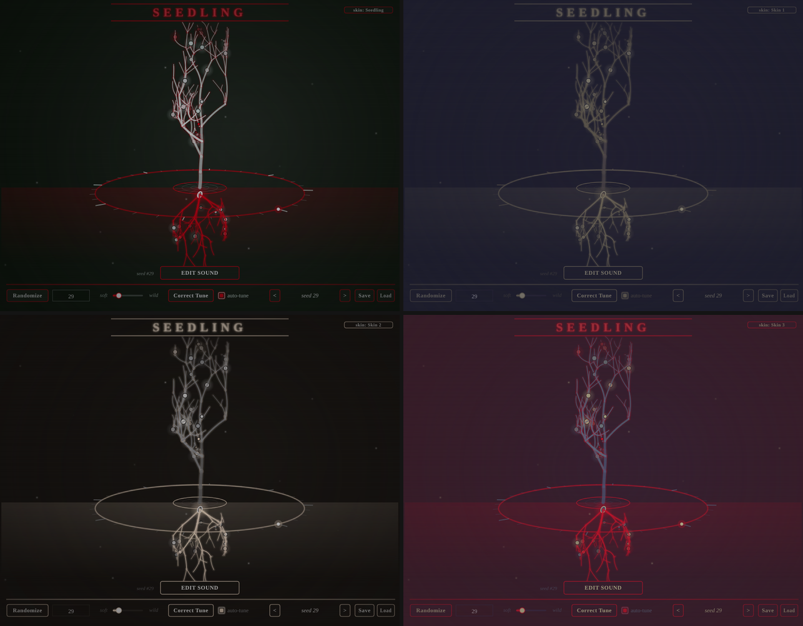
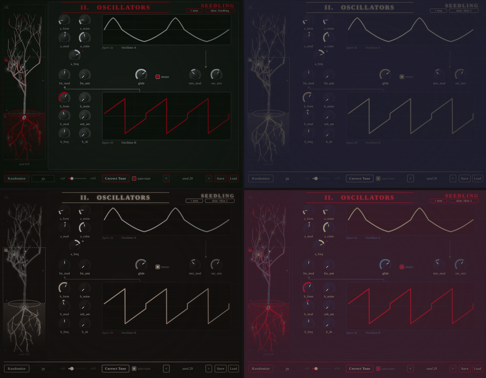

# Seedling

A random-patch synth VST3 (soft and light by default). Every knob from the three pictured pages:
I. Envelope and LFO, II. Oscillators, III. Filter and effects. The pages are picked on a tree grown from a seed: roots = I, trunk and branches = II, canopy = III. Every parameter is a glowing bulb on the tree; each seed grows its own tree. Styled after 80s sci-fi: CRT screens, red neon, scanlines.

## Screenshots
Seedling opens on the **home view**: just the tree turning inside a ring of beat ticks, with Randomize, the seed box, soft/wild, Correct Tune, the preset arrows, Save / Load and the skin button along the bottom. **EDIT SOUND** opens the full three-page editor; **< tree** brings you back. Both views in every built-in skin (Seedling, Skin 1, Skin 2, Skin 3, left to right, top to bottom):





(`seedling_snapshot` regenerates the individual PNGs; see Tests.)

* **Randomize** - new seed each press; the seed box recalls any patch exactly. The soft <-> wild slider sets how far it may stray (default: soft).
* **Correct Tune** - snaps oscillator A to octaves and B to perfect intervals so the keys play in tune. "auto-tune" runs it after every Randomize.
* **Presets** - Save / Load / < > buttons; plain XML `*.seedling` files in `Documents/Seedling/Presets` (12 soft starter presets are created on first run). The host project also stores the full state.
* **Branches move with the sound** - in the editor, the branch carrying a parameter's bulb stretches and lifts as the value rises and shortens and droops as it falls (twigs beyond it follow). Hovering or dragging a control lights its branch and the path back to the seed and names the bulb.
* **3D tree** - the page selector is a tree turning slowly in 3D, one revolution every 8 bars (32 beats) of the host tempo. While the host plays it is locked to the song position; when stopped it keeps turning at the host tempo (120 bpm if the host gives none).
* **Mono + glide** (page II) - the *mono* switch makes the synth monophonic with last-note priority. Playing a key while another is held slides to it legato (envelopes keep running); letting go of the top key slides back to the key still held. *glide* sets the slide time from off to about 3 s, and in mono mode each new note also slides from where the last one was. Randomize leaves mono and glide alone.
* **Skins** - a skin is just five colours, the same as a coolors.co palette. Pick one from the `skin:` button (top right). Skins are small text files in `Documents/Seedling/Skins` - copy one, change the name and the five hex colours, then choose *Reload skins*. Included: Seedling (the original), Skin 1, Skin 2, Skin 3. See the README.txt that Seedling writes into that folder.
```
{ "name": "My Skin", "colors": ["202030", "39304A", "635C51", "7D7461", "B0A990"] }
```
Colours can be in any order (darkest = background, lightest = text, the most vivid of the rest = neon accent); a pasted coolors.co link in a plain text file works too, and `"roles"` lets you assign each colour yourself.
* **Old seeds and presets keep working** - new parameters are appended after the existing ones, so a given seed number grows exactly the same patch as before. Presets and host sessions saved by earlier versions load unchanged (mono and glide come up off).

## Build
Easiest: run `build_windows.bat` (Windows) or `./build_macos.sh` (macOS) from this folder. Both need CMake and a C++ compiler (Visual Studio / Xcode tools); JUCE is downloaded automatically.

Windows / macOS: push to GitHub and download the artifact from the Actions tab (`.github/workflows/build.yml`),
or locally: `cmake -B build -DCMAKE_BUILD_TYPE=Release && cmake --build build --config Release --target Seedling_VST3`.
Copy `Seedling.vst3` into your VST3 folder (Windows: `C:\Program Files\Common Files\VST3`, macOS: `~/Library/Audio/Plug-Ins/VST3`).

## Tests
* `cmake --build build --target seed_engine_test && ctest` - tuning accuracy, random-patch stability and levels.
* `cmake --build build --target seedling_snapshot` - renders the home view and the three pages to PNG (including the README screenshots in every skin) and checks presets / Correct Tune / skins.
