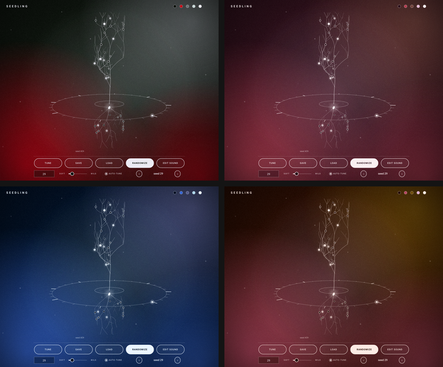
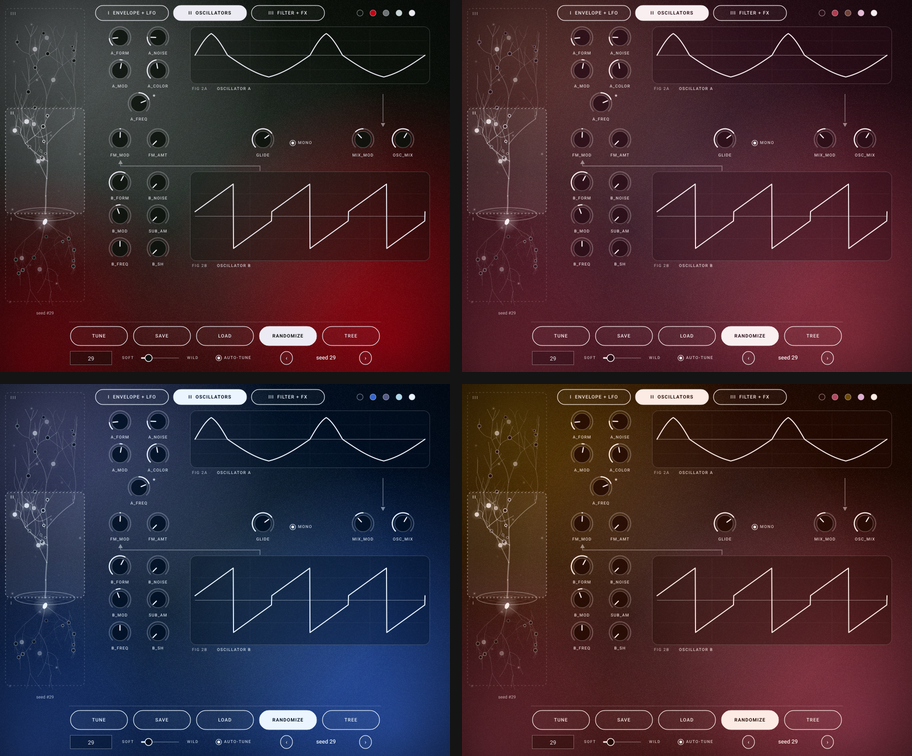

# Seedling

A random-patch synth, as VST3 (Windows, macOS) and Audio Unit (macOS), soft and light by default. Every knob from the three pictured pages:
I. Envelope and LFO, II. Oscillators, III. Filter and effects. The pages are picked on a tree grown from a seed: roots = I, trunk and branches = II, canopy = III. Every parameter is a glowing bulb on the tree; each seed grows its own tree. Styled after 80s sci-fi: CRT screens, red neon, scanlines.

## Screenshots
> **This is the `seed-colors` branch.** There are no skins and no custom colours here: every seed grows its own colours. Seed 0 (no seed yet) is the original Seedling palette; the same seed always gives the same palette, on every machine. The `main` branch keeps the skins.

Seedling opens on the **home view**: the tree turning inside a ring of beat ticks over a full-window gradient. Tune, Save, Load, Randomize and Edit sound sit in one row of equal pills, with the seed box, soft/wild, auto-tune and preset arrows below; the five dots top right show the current seed's colours. **Edit sound** opens the three-page editor (tabs I / II / III, frosted cards, the tree as a sidebar); **Tree** brings you back. Seeds 0, 7, 29 and 4242 (left to right, top to bottom):

(`seedling_snapshot` regenerates the individual PNGs; see Tests.)

* **Randomize** - new seed each press; the seed box recalls any patch exactly. The soft <-> wild slider sets how far it may stray (default: soft).
* **Correct Tune** - snaps oscillator A to octaves and B to perfect intervals so the keys play in tune. "auto-tune" runs it after every Randomize.
* **Presets** - Save / Load / < > buttons; plain XML `*.seedling` files in `Documents/Seedling/Presets` (12 soft starter presets are created on first run). The host project also stores the full state.
* **Branches move with the sound** - in the editor, the branch carrying a parameter's bulb stretches and lifts as the value rises and shortens and droops as it falls (twigs beyond it follow). Hovering or dragging a control lights its branch and the path back to the seed and names the bulb.
* **3D tree** - the page selector is a tree turning slowly in 3D, one revolution every 8 bars (32 beats) of the host tempo. While the host plays it is locked to the song position; when stopped it keeps turning at the host tempo (120 bpm if the host gives none).
* **Mono + glide** (page II) - the *mono* switch makes the synth monophonic with last-note priority. Playing a key while another is held slides to it legato (envelopes keep running); letting go of the top key slides back to the key still held. *glide* sets the slide time from off to about 3 s, and in mono mode each new note also slides from where the last one was. Randomize leaves mono and glide alone.
* **Seed colours** - the palette is built from the seed in OKLCH (ink, accent, slate, mist, paper) with contrast guaranteed: text on the background >= 10:1, on the accent >= 4.5:1, on slate >= 5.5:1. Press Randomize or type a seed and the window glides to the new colours. The palette uses its own hash, so it never changes the sound a seed grows. `seed_palette_test` checks 60,000 seeds in CI.
* **Old seeds and presets keep working** - new parameters are appended after the existing ones, so a given seed number grows exactly the same patch as before. Presets and host sessions saved by earlier versions load unchanged (mono and glide come up off).

## Install
Download the installer for your system from the [Releases](../../releases) page (or from the latest Actions run, under *Seedling-installer-...*):
* **Windows** - `Seedling-<version>-Windows-Setup.exe` installs the VST3 into `C:\Program Files\Common Files\VST3`. Windows SmartScreen may warn because the installer is not code-signed: choose *More info > Run anyway*.
* **macOS** - `Seedling-<version>-macOS.pkg` (universal: Apple Silicon and Intel) installs **VST3** into `/Library/Audio/Plug-Ins/VST3` and the **Audio Unit** into `/Library/Audio/Plug-Ins/Components` (use the AU in Logic Pro, GarageBand and MainStage; use the VST3 in Ableton, Reaper, Bitwig and others). Both are ticked by default; untick one on the *Customize* screen if you only want one. It is not notarised, so open it with right-click > Open the first time.

Maintainers: in the Actions tab choose *Build Seedling > Run workflow* and tick *Publish a GitHub release* (or push a `v*` tag) and CI attaches both installers to a release.

Then rescan plug-ins in your host (Logic: *Settings > Plug-in Manager > Reset & Rescan*). Uninstall on Windows from *Settings > Apps*; on macOS delete `Seedling.vst3` and `Seedling.component` from the folders above. Presets is in `Documents/Seedling` and are kept.

## Build
Easiest: run `build_windows.bat` (Windows) or `./build_macos.sh` (macOS) from this folder. Both need CMake and a C++ compiler (Visual Studio / Xcode tools); JUCE is downloaded automatically.

Windows / macOS: push to GitHub and download the artifact from the Actions tab (`.github/workflows/build.yml`),
or locally: `cmake -B build -DCMAKE_BUILD_TYPE=Release && cmake --build build --config Release --target Seedling_VST3` (on macOS add `Seedling_AU` for the Audio Unit).
Copy `Seedling.vst3` into your VST3 folder (Windows: `C:\Program Files\Common Files\VST3`, macOS: `~/Library/Audio/Plug-Ins/VST3`).

## Tests
* `cmake --build build --target seed_engine_test && ctest` - tuning accuracy, random-patch stability and levels.
* `cmake --build build --target seedling_snapshot` - renders the home view and the three pages to PNG (including the README screenshots for four seeds) and checks presets / Correct Tune / seed colours.

## Fonts

The interface is set in [Roboto](https://fonts.google.com/specimen/Roboto) (Apache/OFL licensed; see `Source/fonts/OFL.txt`), embedded in the plugin.
