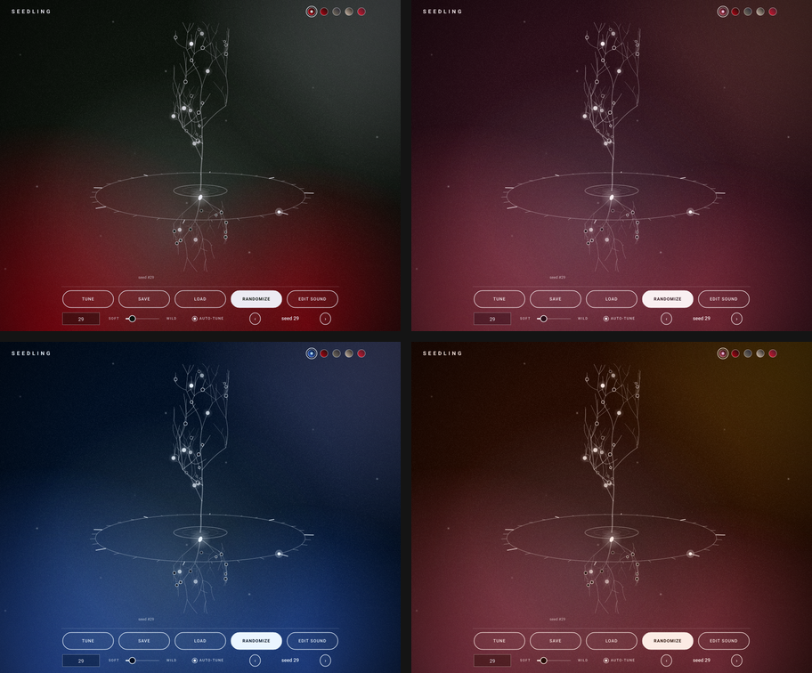
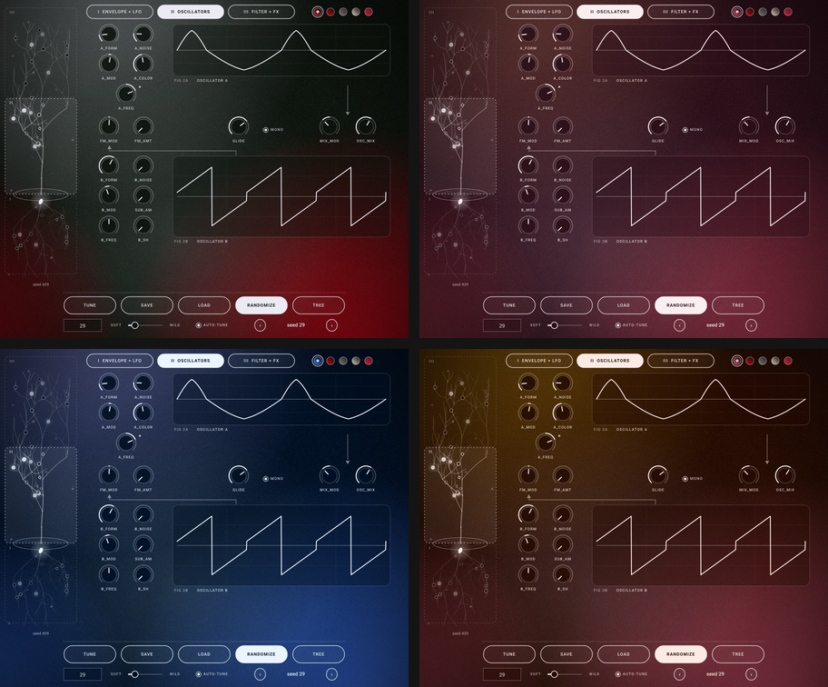
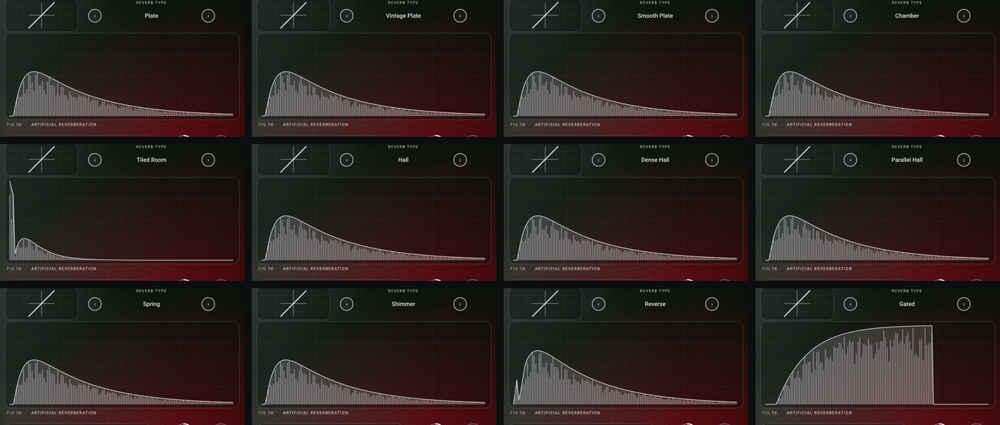

# Seedling

A random-patch synth, as VST3 (Windows, macOS) and Audio Unit (macOS), soft and light by default. Every knob from the three pictured pages:
I. Envelope and LFO, II. Oscillators, III. Filter and effects. The pages are picked on a tree grown from a seed: roots = I, trunk and branches = II, canopy = III. Every parameter is a glowing bulb on the tree; each seed grows its own tree. Styled after 80s sci-fi: CRT screens, red neon, scanlines.

> **Licence note.** The reverbs are recreated after the engines of [DuskVerb](https://github.com/dusk-audio/dusk-audio-plugins) (Dusk Audio, GPL-3.0), so Seedling is now licensed **GPL-3.0** (see `LICENSE`). Earlier versions were not.

## Screenshots
Seedling opens on the **home view**: the tree turning inside a ring of beat ticks over a full-window gradient that drifts slowly in time with the host tempo. Tune, Save, Load, Randomize and Edit sound sit in one row of equal pills, with the seed box, soft/wild, auto-tune and preset arrows below; the dots top right choose the colours. **Edit sound** opens the three-page editor (tabs I / II / III, frosted cards, the tree as a sidebar); **Tree** brings you back. The window resizes with a drag and everything scales to fit.

**Colours.** The first dot is **Seed colours** (the default): every patch seed grows its own palette, and the window glides to the new colours whenever the seed changes. Seeds 0, 7, 29 and 4242, left to right, top to bottom (seed 0 is the original Seedling palette):





The other dots are fixed skins (Seedling, Skin 1, Skin 2, Skin 3, plus your own):


(`seedling_snapshot` regenerates the individual PNGs; see Tests.)

* **Reverb types** - twelve reverbs, picked with the < > selector on page III (next to the saturate card) and saved with the patch and the seed. All use the same six knobs (mix, attack, length, damping, chorus, size); each is a compact recreation of a DuskVerb engine, not a bit-exact port. Soft Randomize favours the halls and plates; Gated and Reverse are rare. Presets and seeds from before the types existed load as Plate.

  | Plate | Vintage Plate | Smooth Plate | Chamber |
  |---|---|---|---|
  | Dattorro cross-coupled plate: input diffusers, modulated tanks, 12-stage density cascade, 3-band damping, 7-tap stereo output | the same tank, darker and steelier | the same tank, denser and calmer | four cross-coupled lines, no modulation, 48 output taps |

  | Tiled Room | Hall | Dense Hall | Parallel Hall |
  |---|---|---|---|
  | sparse early reflections + a short dark tail | 16-line feedback network, bass/mid/treble decay | 8 lines with an allpass in each, modulation everywhere | six bands, each with its own network and decay time |

  | Spring | Shimmer | Reverse | Gated |
  |---|---|---|---|
  | three dispersive spring lines with a little drive | 8 lines with an octave-up shifter in the feedback | rising early reflections into a dark tail | 64-tap tapped delay with a hard gate (length sets the gate time) |

  

* **Randomize** - new seed each press; the seed box recalls any patch exactly. The soft <-> wild slider sets how far it may stray (default: soft).
* **Correct Tune** - snaps oscillator A to octaves and B to perfect intervals so the keys play in tune. "auto-tune" runs it after every Randomize.
* **Presets** - Save / Load / < > buttons; plain XML `*.seedling` files in `Documents/Seedling/Presets` (12 soft starter presets are created on first run). The host project also stores the full state.
* **Branches move with the sound** - in the editor, the branch carrying a parameter's bulb stretches and lifts as the value rises and shortens and droops as it falls (twigs beyond it follow). Hovering or dragging a control lights its branch and the path back to the seed and names the bulb.
* **3D tree** - the page selector is a tree turning slowly in 3D, one revolution every 8 bars (32 beats) of the host tempo. While the host plays it is locked to the song position; when stopped it keeps turning at the host tempo (120 bpm if the host gives none).
* **Mono + glide** (page II) - the *mono* switch makes the synth monophonic with last-note priority. Playing a key while another is held slides to it legato (envelopes keep running); letting go of the top key slides back to the key still held. *glide* sets the slide time from off to about 3 s, and in mono mode each new note also slides from where the last one was. Randomize leaves mono and glide alone.
* **Seed colours** - the first colour dot. The palette is built from the seed in OKLCH (ink, accent, slate, mist, paper) with contrast guaranteed: text on the background >= 10:1, on the accent >= 4.5:1, on slate >= 5.5:1. It uses its own hash, so it never changes the sound a seed grows. `seed_palette_test` checks 60,000 seeds in CI. Choose a fixed skin instead and the colours stay put.
* **Skins** - a skin is just five colours, the same as a coolors.co palette. Pick one with the dots at the top right (right-click them, or the last dot when you have more than five, for the full list). Skins are small text files in `Documents/Seedling/Skins` - copy one, change the name and the five hex colours, then choose *Reload skins*. Included: Seedling (the original), Skin 1, Skin 2, Skin 3. See the README.txt that Seedling writes into that folder.
```
{ "name": "My Skin", "colors": ["202030", "39304A", "635C51", "7D7461", "B0A990"] }
```
Colours can be in any order (darkest = background, lightest = text, the most vivid of the rest = neon accent); a pasted coolors.co link in a plain text file works too, and `"roles"` lets you assign each colour yourself.
* **Archetypes** - Randomize now grows seven-digit seeds from 22 sound recipes (Soft Pad, Choir, Glass Pad, Strings, Pluck, Harp, Marimba, Bell, Gong, Organ, FM Keys, Warm Bass, Brass Swell, Breath, Reverse Swell ...). Each recipe narrows the knobs to what that kind of sound needs, picks a fitting sound source and reverb, so patches differ in character, not only in reverb. The patch name shows the recipe. Soft / wild still sets how far a patch may leave its recipe. Seeds below 1,000,000 (everything made before 0.5) grow exactly the old patches.
* **Sound sources** (page II, under the oscillator A figure) - Oscillator (the original), Wavetable, Pluck (Karplus-Strong string), Vowel (formants), Struck (modal bars and bells) and Unison (seven detuned saws). All of them follow the A knobs and play in tune on every key.
* **Custom wavetables** - choose the Wavetable source, press *Wavetable...* and pick a WAV from `Documents/Seedling/Wavetables` or any other place. Wavetable files (Serum-style: frames of 2048, 1024, 512 or 256 samples, or a Serum `clm` marker) are used frame by frame and *a form* scans through them. **Sampled sounds are tuned the same way Correct Tune tunes the oscillators:** Seedling detects the pitch of the recording (YIN), cuts it into single pitch-matched cycles, resamples each to 2048 points and builds a table from them, so the sample plays at the pitch of the key you press and stays in tune across the keyboard. The info line shows what it found, e.g. "Sampled sound: pitch A#3 -23 ct, tuned to the keys". Unpitched sounds (drums, noise) load as raw frames and are not tuned. The table is stored inside presets and host sessions; seeds never pick a custom table, so they stay reproducible.
* **Old seeds and presets keep working** - new parameters are appended after the existing ones, so a given seed number grows exactly the same patch as before. Presets and host sessions saved by earlier versions load unchanged (mono and glide come up off).

## Install
Download the installer for your system from the [Releases](../../releases) page (or from the latest Actions run, under *Seedling-installer-...*):
* **Windows** - `Seedling-<version>-Windows-Setup.exe` installs the VST3 into `C:\Program Files\Common Files\VST3`. Windows SmartScreen may warn because the installer is not code-signed: choose *More info > Run anyway*.
* **macOS** - `Seedling-<version>-macOS.pkg` (universal: Apple Silicon and Intel) installs **VST3** into `/Library/Audio/Plug-Ins/VST3` and the **Audio Unit** into `/Library/Audio/Plug-Ins/Components` (use the AU in Logic Pro, GarageBand and MainStage; use the VST3 in Ableton, Reaper, Bitwig and others). Both are ticked by default; untick one on the *Customize* screen if you only want one. It is not notarised, so open it with right-click > Open the first time.

Maintainers: in the Actions tab choose *Build Seedling > Run workflow* and tick *Publish a GitHub release* (or push a `v*` tag) and CI attaches both installers to a release.

Then rescan plug-ins in your host (Logic: *Settings > Plug-in Manager > Reset & Rescan*). Uninstall on Windows from *Settings > Apps*; on macOS delete `Seedling.vst3` and `Seedling.component` from the folders above. Presets and skins are in `Documents/Seedling` and are kept.

## Build
Easiest: run `build_windows.bat` (Windows) or `./build_macos.sh` (macOS) from this folder. Both need CMake and a C++ compiler (Visual Studio / Xcode tools); JUCE is downloaded automatically.

Windows / macOS: push to GitHub and download the artifact from the Actions tab (`.github/workflows/build.yml`),
or locally: `cmake -B build -DCMAKE_BUILD_TYPE=Release && cmake --build build --config Release --target Seedling_VST3` (on macOS add `Seedling_AU` for the Audio Unit).
Copy `Seedling.vst3` into your VST3 folder (Windows: `C:\Program Files\Common Files\VST3`, macOS: `~/Library/Audio/Plug-Ins/VST3`).

## Tests
* `cmake --build build --target seed_engine_test && ctest` - tuning accuracy, random-patch stability and levels.
* `cmake --build build --target seedling_snapshot` - renders the home view and the three pages to PNG (including the README screenshots in every skin) and checks presets / Correct Tune / skins.

## Fonts

The interface is set in [Roboto](https://fonts.google.com/specimen/Roboto) (Apache/OFL licensed; see `Source/fonts/OFL.txt`), embedded in the plugin.
